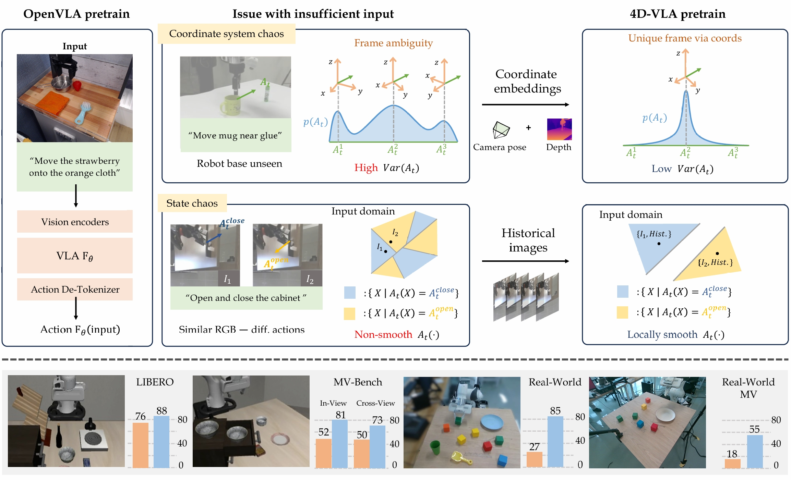

<div align="center" style="font-family: charter;">

<h1><i>4D-VLA</i>:</br> Spatiotemporal Vision-Language-Action Pretraining with Cross-Scene Calibration</h1>

<a href="https://arxiv.org/abs/2506.22242" target="_blank">
    
</a>

<div>
    <span>Jiahui Zhang</span><sup>1*</sup>,
    <span>Yurui Chen</span><sup>1*</sup>,
    <span>Yueming Xu</span><sup>1</sup>,
    <span>Ze Huang</span><sup>1</sup>,
    <span>Yanpeng Zhou</span><sup>2</sup>,
    <span>Yu-Jie Yuan</span><sup>2</sup>,
    <span>Xinyue Cai</span><sup>2</sup>,
    <span>Guowei Huang</span><sup>2</sup>,
    <span>Xingyue Quan</span><sup>2</sup>,
    <span>Hang Xu</span><sup>2</sup>,
    </span>
    <a href="https://lzrobots.github.io/" target="_blank">Li Zhang</a><sup>1</sup></span>
</div>

<div>
    <sup>1</sup>Fudan University&emsp;
    <sup>2</sup>Huawei Noah’s Ark Lab&emsp;
</div>


<p align="justify" style="font-style: italic;">
  <b>Top:</b> Our pretraining design philosophy highlights that prior methods often lack key cues in their input for accurate action inference.
  This leads to target action distributions
  <span style="font-family:monospace;">A<sub>t</sub>(&middot;)</span>
  exhibiting high variance or non-smoothness, which negatively impacts pretraining performance.
  A rough analysis shows that in the DROID dataset, 67% of the samples have the robot’s base occluded, causing coordinate system chaos.
  <br>
  <b>Bottom:</b> We verify our method in both simulated and real-world robotic settings and report the performance for the
  <span style="background-color:#FFD580; padding:2px 4px;">OpenVLA</span> baseline and our
  <span style="background-color:#ADD8E6; padding:2px 4px;">4D-VLA</span> approach.
</p>

</div>

## 🎥 Demo Video

https://github.com/user-attachments/assets/9d74a9d3-3ccf-43d4-981f-e1f2575f6cc1

## 📚 Bibtex

If you find this project or dataset helpful, please consider citing our paper:

```bibtex
@article{zhang2025vla,
    title={4D-VLA: Spatiotemporal Vision-Language-Action Pretraining with Cross-Scene Calibration},
    author={Zhang, Jiahui and Chen, Yurui and Xu, Yueming and Huang, Ze and Zhou, Yanpeng and Yuan, Yujie and Cai, Xinyue and Huang, Guowei and Quan, Xingyue and Xu, Hang and Zhang, Li},
    year={2025},
    journal={arXiv preprint arXiv:2506.22242},
}
```

## Codebase

This repository is organized as a **pure 4D-VLA (InternVL-based) codebase**:

- Core training/model code: `internvl_chat/`
- Experiments / evaluation entrypoints: `experiments/`

## Install

If you see `OSError: [Errno 18] Invalid cross-device link` during `pip install -e`, set pip temp/cache to this repo:

```bash
export TMPDIR="$PWD/.tmp" PIP_CACHE_DIR="$PWD/.pip-cache"
mkdir -p "$TMPDIR" "$PIP_CACHE_DIR"
```

```bash
pip install -e internvl_chat
```

If you run into missing deps, install the full list:

```bash
pip install -r internvl_chat/requirements.txt
pip install -e internvl_chat
```

## End-to-End Pipeline (4 Steps)

1) Pretrain (DROID)  
2) Generate finetune data (Libero / RLDS → jsonl + RGBD frames)  
3) Finetune (Franka or Libero)  
4) Eval (Libero simulation)

### 1) Pretrain (DROID)

- Canonical entry: `internvl_chat/run_pretrain.sh`
- Trainer: `internvl_chat/internvl/train/vla_pretrain_droid_mb.py`
- Dataset meta: `internvl_chat/shell/exp_data/droid_pretrain_mb_20ws_5bs_simple.json`

Data:

- Processed DROID data is hosted on ModelScope: `hutchinsonian/droid_processed`
- The default meta expects (relative to `internvl_chat/`):
  - Images: `../data/droid/droid_processed_data`
  - Annotations: `../data/droid/processed_jsonl_folder_20ws_5bs_simple`

Example (download from ModelScope, then link into the expected layout):

```bash
mkdir -p data/droid

# Option A: via git-lfs
# sudo apt-get install git-lfs  # if needed
# git lfs install
git lfs clone https://www.modelscope.cn/hutchinsonian/droid_processed.git data/droid/_modelscope_droid_processed

# Option B: via Python (requires `pip install modelscope`)
# python - <<'PY'
# from modelscope.hub.snapshot_download import snapshot_download
# snapshot_download('hutchinsonian/droid_processed', local_dir='data/droid/_modelscope_droid_processed', local_dir_use_symlinks=False)
# PY

ln -sfn "$PWD/data/droid/_modelscope_droid_processed/droid_processed_data" data/droid/droid_processed_data
ln -sfn "$PWD/data/droid/_modelscope_droid_processed/processed_jsonl_folder_20ws_5bs_simple" data/droid/processed_jsonl_folder_20ws_5bs_simple
```

If your local paths differ, edit `internvl_chat/shell/exp_data/droid_pretrain_mb_20ws_5bs_simple.json` (`root` / `annotation`) accordingly.

```bash
bash internvl_chat/run_pretrain.sh
```

Common overrides:

```bash
GPUS=8 \
MODEL_NAME_OR_PATH=../hugg_models/InternVL2-4B \
META_PATH=shell/exp_data/droid_pretrain_mb_20ws_5bs_simple.json \
OUTPUT_DIR=work_dirs/4dvla/pretrain_droid_mb_20ws_5bs \
bash internvl_chat/run_pretrain.sh
```

### 2) Generate finetune data (Libero / RLDS)

Script:

- `internvl_chat/tools/prepare_libero_memory_bank.py` (wrapper)
- `internvl_chat/tools/prepare_libero_memory_bank_mb.py` (implementation)

Example:

```bash
python internvl_chat/tools/prepare_libero_memory_bank.py \
  --data-root-dir data \
  --data-mix libero_object_no_noops_3d
#
# or equivalently:
# python internvl_chat/tools/prepare_libero_memory_bank_mb.py --data-root-dir data --data-mix libero_object_no_noops_3d
```

Notes:

- This step typically requires a separate env (TensorFlow/TFDS/dlimp). See `docs/ENV_SETUP.md`.
- Use `--dry-run` to only validate dataset access (no outputs written).

### 3) Finetune (Franka or Libero)

- Franka:
  - Shell: `internvl_chat/run_finetune.sh`
  - Trainer: `internvl_chat/internvl/train/finetune_franka_baseline_pt_mb_aug_dep.py`
- Libero:
  - Shell: `internvl_chat/run_finetune_libero.sh`
  - Trainer: `internvl_chat/internvl/train/run_finetune_libero.py`

```bash
MODEL_NAME_OR_PATH=/path/to/pretrain/checkpoint-XXXXX \
META_PATH=/path/to/franka_meta.json \
  bash internvl_chat/run_finetune.sh
```

```bash
MODEL_NAME_OR_PATH=/path/to/pretrain/checkpoint-XXXXX \
  bash internvl_chat/run_finetune_libero.sh
```

Finetune defaults:

- `run_finetune*.sh` default to `dynamic_image_size=False` and `use_thumbnail=False`. Override via:
  - `USE_DYNAMIC_IMAGE_SIZE=True` / `USE_THUMBNAIL=True`

### 4) Eval (Libero simulation)

Entrypoint:

- Python: `experiments/robot/libero/run_libero_eval_ablation.py`

Scripts:

- Goal tasks (parallel): `experiments/robot/libero/scripts/eval_ablation_exp4_parallel_goal_seed.sh`
- Spatial tasks (parallel): `experiments/robot/libero/scripts/eval_ablation_exp4_parallel_spatial_seed.sh`
- Memory-bank eval launcher: `vla-scripts/exp_eval/eval_whole_mb.sh`

Example:

```bash
PRETRAINED_CHECKPOINT=/path/to/finetune/checkpoint \
  bash experiments/robot/libero/scripts/eval_ablation_exp4_parallel_goal_seed.sh 0
```

Notes:

- Eval requires external deps (LIBERO + robosuite). If missing, the code will error with a clear message at runtime.
- `draccus` is used for CLI parsing; install with project requirements.
